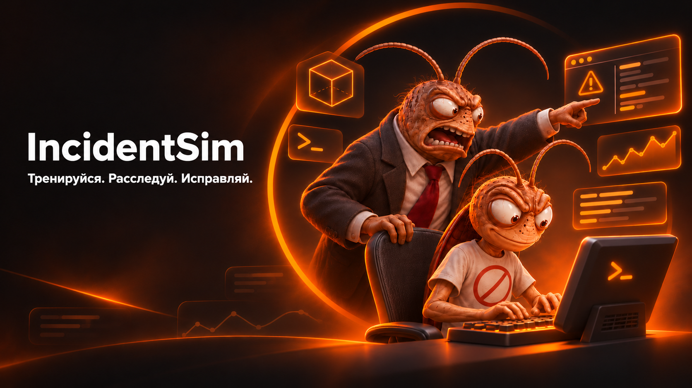

<h1>IncidentSim</h1>

<strong>Платформа для безопасной отработки инженерных инцидентов</strong>

  <a href="https://github.com/IncidentSim">Репозитории проекта</a> ·
  <a href="https://github.com/IncidentSim/tui-ansible-runner/releases">Скачать CLI</a> ·
  <a href="https://github.com/IncidentSim/exersice">Каталог задач</a>

---

Учебная платформа для практики расследования и устранения инцидентов в изолированной песочнице.

> 🪳 **Таракан — маскот IncidentSim.** Инциденты бывают такими же живучими и скрытными, поэтому мы изолируем их, изучаем по следам, устраняем и разбираем после завершения.

### 🪳 Почему таракан?

Таракан напоминает о главном качестве хорошего инженера по эксплуатации: не паниковать перед живучей проблемой, а методично искать причину, проверять гипотезы и оставлять после себя понятный разбор.

## Содержание

- [Об организации и устройстве системы](#об-организации-и-устройстве-системы)
- [Как проходит обучение](#как-проходит-обучение)
- [Возможности](#возможности)
- [Структура проекта](#структура-проекта)
- [Установка](#установка)

## Об организации и устройстве системы

IncidentSim — это система для отработки инцидентов в изолированной среде. Для каждой задачи создаётся отдельная микровиртуальная машина (microVM), которой управляет сервис на базе [Firecracker](https://firecracker-microvm.github.io/). Управление виртуальными машинами доступно через API.

Пользователь взаимодействует с платформой через CLI с terminal UI: выбирает задачу и запускает её выполнение. После запуска для пользователя создаётся персональная виртуальная машина и открывается доступ к веб-терминалу с файловой системой окружения. В терминале можно исследовать инцидент, менять файлы и устранять проблему, а затем через CLI вызвать проверку решения.

После верификации система формирует постмортем-отчёт о действиях пользователя. Действия собираются агентом на базе `auditd`, а затем анализируются и оформляются с помощью LLM.

Участник сталкивается со сбоем в учебном сервисе, изучает логи и метрики, диагностирует причину, вносит исправление и получает автоматическую проверку результата. Ошибки не затрагивают реальные системы, поэтому задачу можно безопасно перезапускать, пробовать разные подходы и возвращаться к исходному состоянию.

## Как проходит обучение

> **Цикл обучения:** задача → изолированная microVM → веб-терминал → проверка → постмортем.

Каждая задача представлена в виде карточки с:

1. Получение описания задачи.
2. Получение подсказок по запросу.
3. Решение задачи в веб-терминале.
4. Верификация через CLI в консоли пользователя.
5. Получение разбора действий пользователя от LLM.

После завершения задачи платформа автоматически формирует черновик постмортема. В него входят таймлайн действий участника, найденная корневая причина, сравнение с эталонным решением и итоговая оценка.

## Возможности

### 📚 Каталог задач

Каталог задач, доступных для решения, находится в [отдельном репозитории](https://github.com/IncidentSim/exersice).

### 💻 Контролируемый терминал

Терминал предоставляет ограниченный доступ внутрь учебного сервиса. Через него можно работать с файлами и процессами в рамках разрешённых условий задачи.

### 🧭 Подсказки

Подсказки выдаются по запросу и образуют лестницу — от общего направления расследования до почти готового ответа. Факт использования каждой подсказки фиксируется в журнале событий и учитывается при формировании результата.

### 📝 Автоматический постмортем

Черновик постмортема собирается из журнала событий, а не генерируется без опоры на действия участника. Он содержит:

- последовательность действий и таймлайн;
- найденную корневую причину;
- сравнение решения участника с эталоном;
- рекомендации по итогам разбора.

## Структура проекта

Проект разделён на несколько репозиториев:

| Репозиторий | Назначение |
| --- | --- |
| [tui-ansible-runner](https://github.com/IncidentSim/tui-ansible-runner) | CLI с terminal UI для выбора задач, запуска окружения и проверки решений |
| [audit-agent](https://github.com/IncidentSim/audit-agent) | Агент аудита действий пользователя на базе `auditd` |
| [vmmanager](https://github.com/IncidentSim/vmmanager) | Управление microVM через Firecracker и API виртуальных машин |
| [exersice](https://github.com/IncidentSim/exersice) | Список и описания учебных задач |

## Установка

Готовые бинарные файлы CLI доступны на странице релизов:

<a href="https://github.com/IncidentSim/tui-ansible-runner/releases"><strong>Скачать tui-ansible-runner</strong></a>

